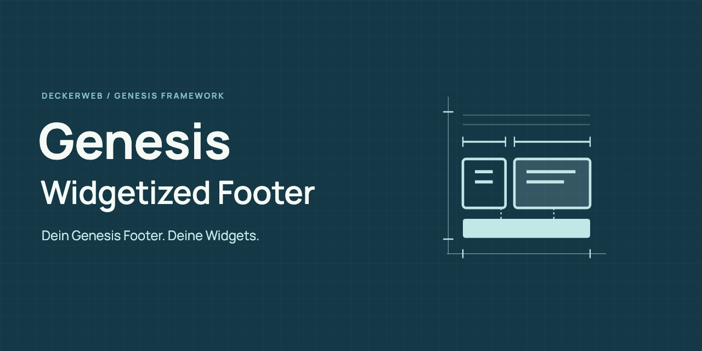

# Genesis Widgetized Footer

Dein Genesis Footer. Deine Widgets.

[English](README.md)

Gestalte die Genesis-Fußzeile für Copyright und Credits mit zwei Widget-Bereichen und einem optionalen Disclaimer. Vorhandene Widgets und Shortcode-Namen bleiben erhalten.

**2.0.1 · WordPress ≥6.4 · PHP ≥8.1 · Genesis Framework**

[FAQ](FAQ-de.txt) · [Änderungsverlauf](CHANGELOG-de.txt)

[Wiki](https://github.com/deckerweb/genesis-widgetized-footer/wiki/Start) · [Sicherheit](SECURITY-de.md) · [GitHub-Releases](https://github.com/deckerweb/genesis-widgetized-footer/releases)

## Inhalt

- [Auf einen Blick](#auf-einen-blick)
- [Installation](#installation)
- [FAQ](#faq)
- [Änderungsverlauf](#changelog)

## Auf einen Blick

* Einrichtungsstatus und Widget-Anzahl mit direkten Bearbeitungslinks.
* Ein Bereich in voller Breite oder zwei responsive Spalten im Verhältnis 1:2, 1:1 oder 2:1.
* Anzeige auf Landingpages und optionaler Disclaimer innerhalb oder nach dem Theme-Footer.
* Shortcodes kopieren, Frontend testen und Customizer-Vorschau öffnen.
* Lokale Dokumentation, Deutsch mit Du/Sie, deckerweb Library 1.1.0 und Updater 2.2.0.

## Installation

Lade das Plugin-ZIP unter Plugins > Installieren > Plugin hochladen hoch. Aktiviere es und öffne Genesis > Widgetized Footer. Inhalte fügst du unter Design > Widgets hinzu. Ohne Genesis findest du die Einstellungen unter Einstellungen > Widgetized Footer; die Theme-Funktionen pausieren dann sicher.

## Hauptfunktionen

Die beiden Hauptbereiche ersetzen den Copyright- und Credits-Bereich. Der optionale Disclaimer ergänzt einen Hinweistext. Die Anzeigeoptionen gelten je Website; Shortcodes geben zugewiesene Widgets an ihrer Einfügeposition aus.

## FAQ

### Ändert das Plugin die normalen Footer-Widget-Spalten des Themes?

Nein. Das Plugin ändert den Copyright- und Credits-Bereich. Die vorhandenen Footer-Widget-Spalten des Themes bleiben eigenständig.

### Wie beginne ich?

Füge unter Design > Widgets Inhalte zu Footer-Bereich #1, Footer-Bereich #2 oder Footer-Disclaimer hinzu. Unter Genesis > Widgetized Footer findest du Status und Anzeigeoptionen.

### Was passiert bei leeren Bereichen?

Leere Bereiche bleiben verborgen. Sind beide Hauptbereiche leer, bleibt der Genesis-Standardfooter erhalten. Ein einzelner belegter Hauptbereich nutzt die volle Breite. Widgets mit eigenen Anzeigeregeln können trotzdem eine leere Ausgabe erzeugen.

### Wie funktionieren Landingpages?

Erkannt werden die fünf bisherigen Templates: page_landing.php, page-landing.php, landing.php, template-landing.php und template_page-landing.php. Die Hauptbereiche sind dort standardmäßig verborgen, der Disclaimer bleibt aktiviert. Beides ist einstellbar. Theme-Templates können Footer-Hooks unabhängig davon entfernen.

### Bleiben meine Widgets beim Update erhalten?

Ja. Alle drei Sidebar-IDs und beide Shortcodes bleiben erhalten. Deaktivierung und Deinstallation behalten Widget-Inhalte, Zuordnungen und die Einstellungen dieser Website. Eine automatische Inhaltsmigration ist nicht nötig.

### Funktioniert die Netzwerkaktivierung?

Einstellungen und Widget-Zuordnungen gelten je Website. Die Theme-Integration läuft nur bei aktivem Genesis. Andere Websites behalten ihre Theme-Ausgabe.

### Welche Daten verlassen die Website?

Der Updater fragt bei WordPress-Updateprüfungen GitHub nach Plugin-Releases ab. Der optionale Library-Onlinekatalog ist anfangs ausgeschaltet. Bewusste Library-Installationen laden die ausgewählten Pakete herunter. Es gibt keine Telemetrie.

Vollständige Fragen nach Themen: FAQ-de.txt

## Changelog

### 2.0.1

* Verbessert: deckerweb Library 1.1.0 und Updater 2.2.0 mit robusterer gemeinsamer Updateversorgung.
* Verbessert: Sicherere lokale Dokumentationsdialoge.
* Behoben: Lokale Dokumentation berücksichtigt die formelle deutsche Admin-Sprache.
* Sonstiges: Benötigt PHP 8.1; WordPress 6.4 bleibt unterstützt.

### 2.0.0

* Neu: Website-Einstellungen mit Einrichtungsstatus, Vorschau und Shortcode-Kopierfunktion.
* Neu: Responsive Spaltenverhältnisse sowie einstellbare Landingpage- und Disclaimer-Anzeige.
* Verbessert: Sichere Pause ohne Genesis je Website, erhaltene Widget-IDs und Deutsch mit Sie-Anrede.
* Verbessert: Die Abfrage des letzten Änderungsdatums lädt keine unbenötigten Metadaten oder Taxonomie-Zuordnungen.
* Verbessert: Freigegebene Blueprint-Grafiken und neuer Genesis-Slogan im Admin, in der Dokumentation und in Plugin-Updateinformationen.
* Behoben: Position der Widget-Shortcode-Ausgabe, Warnung ohne Bereichsangabe, Metro-Landingpage-Ausnahme und Disclaimer-Theme-Erkennung.
* Behoben: Rekursive Widget-Bereich-Shortcodes enden sicher; Wrapper-Tags werden geprüft.
* Sonstiges: Benötigt WordPress 6.4 und PHP 8.0. Enthält Library 1.0.0 und Updater 2.1.0.

### 1.4.0 · 2013-05-08

* Neu: Metro-Child-Theme-Anpassung und Shortcodes für Widget-Bereiche und letztes Änderungsdatum.
* Verbessert: Bedingtes Laden im Frontend, Stylesheet-Cache und deutsche Übersetzungen.

### 1.3.0 · 2012-12-15

* Neu: Konstanten zum Abschalten von Widget-Shortcodes und Disclaimer-Bereich.
* Verbessert: Klassen-Platzhalter für Widgets und Übersetzungen.

### 1.2.0 · 2012-08-20

* Neu: Landingpage-Templates, Genesis-Hilfe und RealPro-Anpassung.
* Verbessert: Disclaimer-Darstellung, komprimiertes CSS und Übersetzungen.

### 1.1.0 · 2012-04-27

* Neu: Hilfe in der Widget-Verwaltung.
* Verbessert: Bedingtes Laden von Stylesheets und Plugin-Links.
* Behoben: Beschreibung des zweiten Widget-Bereichs.

### 1.0.0 · 2012-04-25

* Neu: Erstveröffentlichung.

## David Decker – DECKERWEB

Seit 2012 ein schlanker Helfer für Genesis-Websites.

## Support

Fragen und normale Fehler bitte über GitHub Issues melden. Sicherheitsprobleme vertraulich über https://github.com/deckerweb/genesis-widgetized-footer/security/advisories/new melden. Bitte Plugin-/Library-Version, WordPress-/PHP-Version, Reproduktionsschritte und Auswirkungen angeben; keine Zugangsdaten teilen. Sicherheitsdetails nicht öffentlich posten.

## Library / Updater

Updates kommen ausschließlich über stabile GitHub-Releases dieses Repositories. WordPress.org ist kein Vertriebskanal. Beim Entfernen des letzten Library-Hosts werden eigene temporäre Daten bereinigt; gemeinsame Einstellungen bleiben standardmäßig erhalten. Widget-Inhalte und Website-Einstellungen bleiben erhalten.

## Copyright / GPL

Copyright 2012–2026 David Decker – DECKERWEB. GPL v2 oder höher. Gemeinsame Library 1.1.0 und Updater 2.2.0: David Decker – DECKERWEB, GPL-2.0-or-later. Der lokale Dokumentations-Footer samt Renderer folgt der gemeinsamen deckerweb-Implementierung aus Genesis Widgetized Not Found & 404 2.0.0. Theme-Implementierungscode ist nicht enthalten. Grafikgestaltung: David Decker – DECKERWEB, GPL-2.0-or-later. Manrope: Copyright 2018 The Manrope Project Authors, SIL OFL 1.1; siehe assets/licenses/Manrope-OFL.txt. SVG-Icon mit nativen Formen und eingebetteter OFL-Schrift, ohne Rasterbilder oder externe Ressourcen.

Unterstützung: [Ko-fi](https://ko-fi.com/deckerweb) · [Buy Me a Coffee](https://buymeacoffee.com/daveshine) · [PayPal](https://paypal.me/deckerweb)
