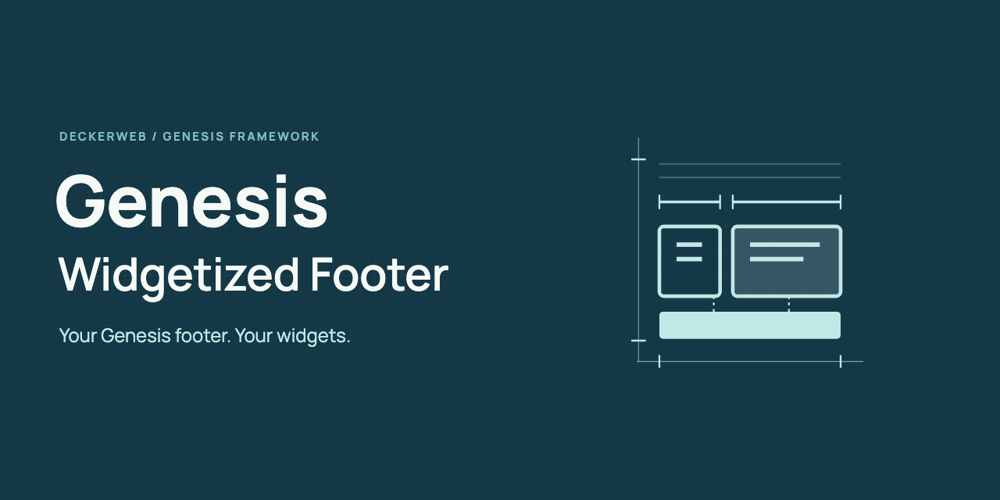

# Genesis Widgetized Footer

Your Genesis footer. Your widgets.

[Deutsch](https://github.com/deckerweb/genesis-widgetized-footer/blob/main/README-de.md)

Customize the Genesis copyright and credits footer with two widget areas and an optional disclaimer. Existing widgets and shortcode names are preserved.

**2.0.1 · WordPress ≥6.4 · PHP ≥8.1 · Genesis Framework**

[FAQ](FAQ.txt) · [Changelog](CHANGELOG.txt)

[Wiki](https://github.com/deckerweb/genesis-widgetized-footer/wiki) · [Security](SECURITY.md) · [GitHub releases](https://github.com/deckerweb/genesis-widgetized-footer/releases)

## Contents

- [At a glance](#at-a-glance)
- [Installation](#installation)
- [FAQ](#faq)
- [Changelog](#changelog)

## At a glance

* Setup status and widget counts with direct edit links.
* One full-width area, or two responsive columns in 1:2, 1:1 or 2:1 proportions.
* Landing-page visibility and an optional disclaimer inside or after the theme footer.
* Shortcode copying, frontend testing and Customizer preview.
* Local documentation, informal/formal German, deckerweb Library 1.1.0 and Updater 2.2.0.

## Installation

Upload the plugin ZIP under Plugins > Add New > Upload Plugin. Activate it, then open Genesis > Widgetized Footer. Add content under Appearance > Widgets. Without Genesis, settings are under Settings > Widgetized Footer and theme features pause safely.

## Main features

The two main areas replace the copyright and credits footer. The optional disclaimer adds a separate notice. Display settings apply per website; shortcodes render assigned widgets at their insertion point.

## FAQ

### Does this change the theme’s regular footer widget columns?

No. The plugin changes the copyright and credits area. The theme’s existing footer widget columns remain separate.

### How do I get started?

Add widgets to Footer Area #1, Footer Area #2 or Footer Disclaimer under Appearance > Widgets. Open Genesis > Widgetized Footer to review setup and display settings.

### What happens when an area is empty?

Empty areas stay hidden. When both main areas are empty, the standard Genesis footer remains. One populated main area uses the full width. Widgets with their own visibility rules can still produce an empty result.

### How do landing pages work?

The five historical landing templates are recognized: page_landing.php, page-landing.php, landing.php, template-landing.php and template_page-landing.php. Main areas are hidden there by default; the disclaimer remains enabled. Both are configurable. Theme templates may independently remove footer hooks.

### Will an update preserve my widgets?

Yes. All three sidebar IDs and both shortcodes are preserved. Deactivation and uninstall retain widget content, assignments and this website’s settings. No automatic content migration is needed.

### Does network activation work?

Settings and widget assignments belong to each website. Theme integration runs only where Genesis is active. Other websites keep their theme output.

### What data is sent outside the website?

The updater checks GitHub for plugin releases during WordPress update checks. The optional Library online catalog starts disabled. Explicit Library installations download selected packages. No telemetry is included.

Complete FAQ by topic: FAQ.txt

## Changelog

### 2.0.1

* Improved: deckerweb Library 1.1.0 and Updater 2.2.0 with more reliable shared update handling.
* Improved: Safer local documentation dialogs.
* Fixed: Local documentation follows the formal German administration language.
* Misc: Requires PHP 8.1; WordPress 6.4 remains supported.

### 2.0.0

* New: Website settings with setup status, preview links and shortcode copying.
* New: Responsive column ratios and configurable landing-page and disclaimer display.
* Improved: Safe per-site pause without Genesis, preserved widget identities and formal German.
* Improved: Latest-update queries skip unnecessary metadata and taxonomy caches.
* Improved: Blueprint artwork and the new Genesis slogan in administration, documentation and plugin update information.
* Fixed: Widget shortcode placement and missing-attribute warnings, Metro landing-page removal and disclaimer theme detection.
* Fixed: Recursive widget-area shortcodes terminate safely; wrapper tags are validated.
* Misc: Requires WordPress 6.4 and PHP 8.0. Includes Library 1.0.0 and Updater 2.1.0.

### 1.4.0 · 2013-05-08

* New: Metro child-theme integration and widget-area/latest-update shortcodes.
* Improved: Conditional frontend loading, stylesheet caching and German translations.

### 1.3.0 · 2012-12-15

* New: Constants to disable widget shortcodes and the disclaimer area.
* Improved: Widget class placeholders and translations.

### 1.2.0 · 2012-08-20

* New: Landing-template handling, Genesis help and RealPro integration.
* Improved: Disclaimer styling, compressed CSS and translations.

### 1.1.0 · 2012-04-27

* New: Widget administration help.
* Improved: Conditional stylesheet loading and plugin links.
* Fixed: Second widget-area description.

### 1.0.0 · 2012-04-25

* New: Initial release.

## David Decker – DECKERWEB

A small helper for Genesis websites since 2012.

## Support

Use GitHub Issues for questions and ordinary bugs. Report vulnerabilities privately at https://github.com/deckerweb/genesis-widgetized-footer/security/advisories/new. Include plugin/Library versions, WordPress/PHP versions, reproduction steps and impact; never include credentials or post security details publicly.

## Library / Updater

Updates use stable GitHub releases from this repository. The plugin is not distributed through WordPress.org. Removing the final Library host clears owned temporary data; shared settings remain by default. Widget content and website settings are preserved.

## Copyright / GPL

Copyright 2012–2026 David Decker – DECKERWEB. GPL v2 or later. Shared Library 1.1.0 and Updater 2.2.0: David Decker – DECKERWEB, GPL-2.0-or-later. The local document footer/renderer follows the shared deckerweb implementation used by Genesis Widgetized Not Found & 404 2.0.0. No theme implementation code is bundled. Artwork: David Decker – DECKERWEB, GPL-2.0-or-later. Manrope: Copyright 2018 The Manrope Project Authors, SIL OFL 1.1; see assets/licenses/Manrope-OFL.txt. SVG icon uses native shapes and an embedded OFL font, without raster images or external resources.

Support: [Ko-fi](https://ko-fi.com/deckerweb) · [Buy Me a Coffee](https://buymeacoffee.com/daveshine) · [PayPal](https://paypal.me/deckerweb)
